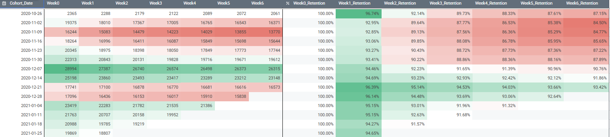
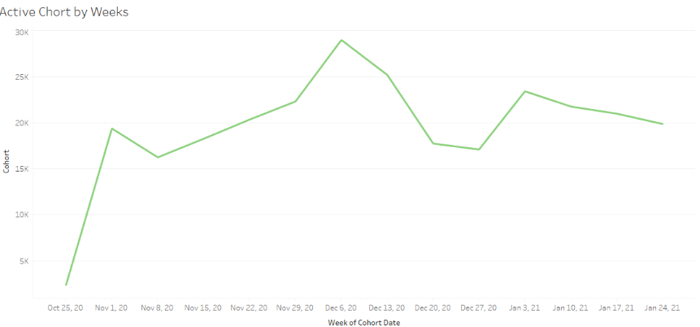

# Subscription Churn — Weekly Cohort Retention Analysis

Weekly cohort analysis of subscription retention, tracking users from the week they subscribed (Week 0) through Week 6, using SQL in BigQuery and visualization in Google Sheets and Tableau.

---

## Skills

### SQL (BigQuery), Cohort Analysis, Retention Analysis, Google Sheets, Tableau

---

## Business Context

The Product Manager suspected that monthly retention reporting was too slow and could hide important churn patterns. The goal of this project was to measure **weekly retention** so that drop-offs can be spotted earlier.

The analysis was based on the `turing_data_analytics.subscriptions` table and assumed an analysis date of **2021-02-07**.

---

## Goal

- Calculate weekly retention for cohorts of users grouped by the week their subscription started.
- Track how many users from each cohort remain active from **Week 0 to Week 6**.
- Visualize retention to reveal trends and drop-off points.

---

## Approach

1. **Explored the data:** Reviewed the subscription start and end dates and the user identifier, and checked for missing values and duplicates.
2. **Defined cohorts:** Truncated each subscription start date to the Monday of its week, so every user belongs to exactly one weekly cohort.
3. **Built the retention logic:** Used conditional aggregation to count active users in each week after the start (Week 0 to Week 6).
4. **Calculated retention rates:** Divided each week's active count by the cohort's Week 0 size.
5. **Exported and visualized:** Sent the results to Google Sheets and built a heatmap plus a line chart in Tableau.

---

## Results

### Cohort Table: Active Users and Retention by Week

The table shows the number of active users for each weekly cohort (left) and the corresponding retention percentage (right). Colors go from red (low) to green (high) to make comparisons easier.

### Cohort Size Over Time

The line chart shows how many new subscribers joined each weekly cohort.

---

## Key Insights

- **Week 1 is the biggest drop-off point.** Most cohorts lose about 3–7% of users in their first week after starting, with the largest losses in the Nov 2020 cohorts. After that, retention declines more slowly.
- **Retention decays steadily after Week 1.** Most cohorts lose roughly 1–2 percentage points per week from Week 2 to Week 6.
- **Early November cohorts retained the least.** The cohort starting 2020-11-09 kept only about **84.8%** of users by Week 6, the lowest in the table.
- **December cohorts retained the best.** The 2020-12-21 cohort kept about **93.4%** of users by Week 6, and the 2020-12-07 cohort had the largest starting size (about **29,000** users).
- **Cohort sizes fluctuate.** The number of new subscribers peaked in early December 2020 and dropped in late December before recovering in early January.

---

## Recommendations

- **Focus retention efforts on Week 1.** Onboarding emails, reminders, or in-app prompts in the first 7 days could reduce the largest drop-off.
- **Investigate the November 2020 cohorts.** Find out what differed for these users (acquisition channel, promotion, product changes, or seasonal behavior) and apply any lessons to future cohorts.
- **Track weekly cohorts going forward.** Monitor Week 1 retention as an early warning indicator, since it reveals problems weeks before monthly reports would.

---

## Limitations

- The most recent cohorts have incomplete data. For example, a cohort that started in late January 2021 has no Week 2 or later data as of 2021-02-07, so its later weeks are excluded.
- Retention is based on activity in each week, and the definition of "active" depends on the subscription fields in the dataset.
- Seasonal effects (for example, the holiday period) may influence both cohort size and retention, so the differences should be interpreted with care.

---

## Appendix

- **SQL query and results:** [Google Sheets Link](https://docs.google.com/spreadsheets/d/10b-V4FY6_T0WTMGEP1Zq9hK0cy6fidciNjwf1tOaGCo/edit?usp=sharing)

---

**Conclusion:**
Weekly cohort analysis showed that most churn happens in the first week after subscribing, and that retention varies noticeably between cohorts. Week 1 onboarding and the November 2020 cohorts are the most promising areas to investigate next.
