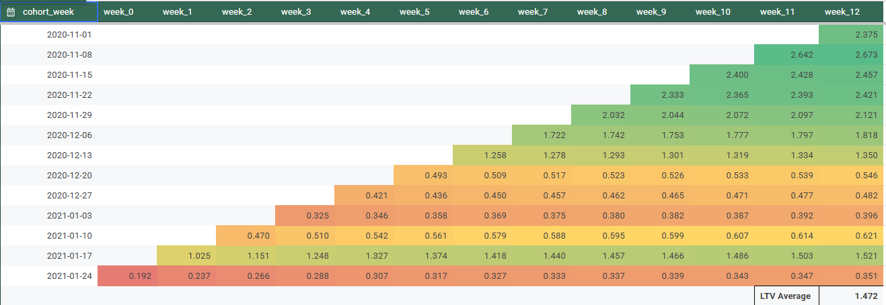

# Subscription Cohort Analysis: Weekly Retention, ARPU, and LTV

Weekly cohort analysis of subscription users, tracking how many users stay active (retention) and how much revenue each cohort generates per user (ARPU and cumulative ARPU) over 12 weeks, with an LTV estimate per cohort. Built with SQL in BigQuery and visualized in Google Sheets and Tableau.

---

## Skills

### SQL (BigQuery), Cohort Analysis, Retention Analysis, ARPU, LTV, Google Sheets, Tableau

---

## Business Context

The Product Manager believed monthly retention reporting was too slow and could hide important churn patterns. This project measures retention weekly, and extends the analysis to revenue so the business can see how much each cohort is worth over time.

The analysis uses the `turing_data_analytics.subscriptions` table and assumes an analysis date of **2021-02-07**.

---

## Goal

- Calculate weekly retention for cohorts grouped by the week their subscription started, from Week 0 to Week 6.
- Measure ARPU (average revenue per user) for each cohort by week, and the cumulative ARPU over time.
- Estimate LTV (lifetime value) per cohort and compare cohorts.
- Identify where engagement and revenue flatten, and suggest where to act.

---

## Approach

1. **Explored the data:** Reviewed subscription start and end dates and the user identifier, and checked for missing records and duplicates.
2. **Defined cohorts:** Truncated each subscription start date to the Monday of its week, so every user belongs to exactly one weekly cohort.
3. **Retention:** Used conditional aggregation to count active users per cohort for each week (Week 0 to Week 6), then divided by the Week 0 cohort size.
4. **ARPU:** Calculated revenue per user for each cohort and week.
5. **Cumulative ARPU and LTV:** Summed ARPU across weeks for each cohort to get cumulative ARPU. The latest value for each cohort is its LTV to date.
6. **Visualized:** Built heatmap-style cohort tables in Google Sheets and a trend chart in Tableau.

---

## SQL

- **SQL query and results:** [Google Sheets Link](https://docs.google.com/spreadsheets/d/10b-V4FY6_T0WTMGEP1Zq9hK0cy6fidciNjwf1tOaGCo/edit?usp=sharing)

[Google Sheets Link Second Part](https://docs.google.com/spreadsheets/d/1-MdNJ8YA6wguNS1CpIuRyKY-OWR0V2mQhXeNuaDefIs/edit?gid=406087049#gid=406087049)
```sql
-- Retention query
-- ARPU query
-- Cumulative ARPU query
```

---

## Results

### 1. Weekly Retention by Cohort


Each row is a weekly cohort and each column is a week after subscribing. Colors run from red (low) to green (high).

### 2. Cohort Size Over Time


The line chart shows how many subscribers joined each weekly cohort. The peak was in early December 2020, followed by a dip and a recovery in early January 2021.

### 3. ARPU by Cohort and Week


Average revenue per user for each cohort and week. Week 0 averages **$0.86** across cohorts, and it falls to **$0.20** in Week 1 and **$0.13** in Week 2.

### 4. Cumulative ARPU by Cohort


Running total of ARPU for each cohort. The bottom row shows the average across cohorts for each week, and the growth row shows the week-over-week increase in that average.

### 5. LTV by Cohort



Cumulative ARPU to date for each cohort. The newest cohorts have fewer weeks of data, so the overall LTV average (**$1.47**) mixes cohorts of different ages.

---

## Key Insights

- **Retention drops sharply after the first week.** The average Week 0 cohort is at 100%, and by Week 1 retention falls to about 20% of the cohort's starting size in the table. Beyond Week 4, the cohorts keep less than 5% of their original users, so engagement is very low.
- **Cohorts vary a lot in starting value.** Week 0 ARPU ranges from **$0.19** (2021-01-24) to **$1.65** (2020-11-22). Most cohorts from 2020-12-20 to 2021-01-10 start below $0.40, while November and early December cohorts start between $1.00 and $1.65.
- **Most of the revenue arrives early.** Cumulative ARPU rises from **$0.86** at Week 0 to **$1.37** by Week 4, which is about 72% of the total 12-week gain (to **$1.57**). After Week 6, weekly growth is small.
- **Growth flattens quickly.** Cumulative ARPU grows **23%** from Week 0 to Week 1, but only **1.2%** from Week 11 to Week 12.
- **November 2020 cohorts are the most valuable.** They reached about **$2.4 to $2.7** in cumulative ARPU by Week 12. The 2020-12-06 cohort is lower at about **$1.82** at its latest point, though it has less time to accumulate.
- **Early retention and revenue move together.** Cohorts with stronger Week 0 ARPU, such as November and early December, also generate more revenue over time.

---

## Recommendations

- **Focus on the first two weeks.** Retention and revenue both fall most sharply in the first two weeks. Onboarding, personalized reminders, and targeted offers in this window would have the biggest effect.
- **Investigate the weak cohorts.** Find out why cohorts starting from late December 2020 to January 2021 begin with lower ARPU. Check acquisition channel, pricing, promotions, and seasonality.
- **Re-engage users in weeks 4 to 6.** Growth slows after Week 4. New features, loyalty rewards, or campaigns in this period could extend the curve.
- **Use LTV for planning.** Set acquisition spend limits based on expected LTV by cohort, not just on the average, since cohort quality differs widely.

---

## Limitations

- Recent cohorts have incomplete data. A cohort that started on 2021-01-24 has only about two weeks of history as of 2021-02-07, so its LTV is an early estimate.
- The LTV average combines cohorts of different ages, so it understates the value of mature cohorts and overstates the value of new ones.
- Retention depends on how "active" is defined in the dataset.
- Seasonal effects, such as the holiday period, may influence both cohort size and ARPU.

---

**Conclusion:**
Most subscription value is generated in the first four weeks, and revenue growth flattens after that. November 2020 cohorts were the most valuable, while late-December and January cohorts started weak. The biggest opportunities are improving the first two weeks, understanding why later cohorts started lower, and re-engaging users in weeks 4 to 6.
