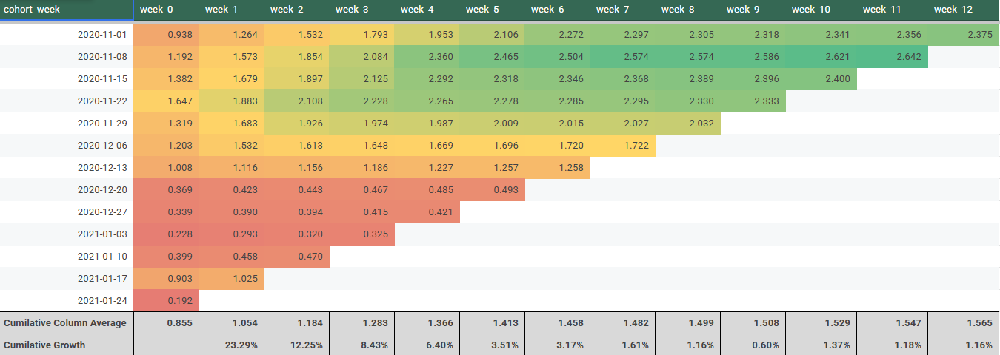
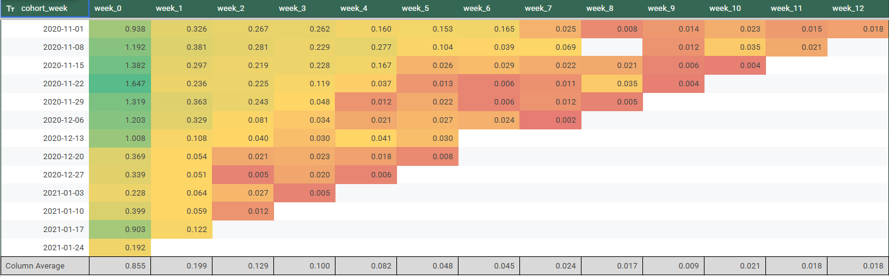

# Customer Lifetime Value (CLV) — Weekly Cohort ARPU Analysis

Cohort-based CLV analysis of **all website visitors** (not only buyers). Users are grouped by the week of their first event (registration cohort), and their revenue is tracked over 12 weeks as Average Revenue per User (ARPU), cumulative ARPU, and a forecast for cohorts that have not yet reached week 12.

---

## Skills

### SQL (BigQuery), Cohort Analysis, ARPU, CLV / LTV, Forecasting, Google Sheets

---

## Business Context

The manager considered the Shopify CLV formula too simplistic and wanted a more reliable, cohort-based estimate. The previous analysis had two weaknesses:

1. It included **only purchasing customers**, while marketing considers every visitor.
2. It assumed long customer lifetimes, while users rarely stay engaged for long.

This analysis fixes both: all visitors are included, and value is measured over a **12-week window**.

**Data:** `turing_data_analytics.raw_events`
**Current week:** 2021-01-24 (the last weekly cohort in the dataset)

---

## Goal

- Build weekly registration cohorts from each user's first event.
- Calculate weekly ARPU per cohort for weeks 0 to 12.
- Convert ARPU to cumulative ARPU and measure week-over-week growth.
- Forecast the missing weeks for newer cohorts and estimate an average 12-week CLV.

---

## Approach

1. **Registration cohort:** Found each user's first event date using `user_pseudo_id` and truncated it to the start of the week.
2. **Revenue data:** Extracted weekly purchase revenue per user and put the dates in the same weekly format as the cohorts.
3. **Joined cohorts and revenue:** Calculated the week offset between registration and each purchase (week 0 to 12).
4. **ARPU:** Divided each cohort's weekly revenue by the number of users in that cohort, including users who never purchased.
5. **Cumulative ARPU:** Added each week's ARPU to the running total, based on the first table.
6. **Cumulative growth %:** Calculated the week-over-week growth of the average cumulative ARPU.
7. **Forecast:** Applied the average cumulative growth % to each cohort's latest known value to fill the remaining weeks up to week 12. Example: for the 2021-01-24 cohort, $0.192 × (1 + 23.29%) ≈ $0.237 for week 1.
8. **CLV:** Averaged the week-12 cumulative ARPU across all cohorts.

---

## SQL

```sql
WITH registration_cohort AS (
  SELECT
    user_pseudo_id,
    DATE_TRUNC(MIN(PARSE_DATE('%Y%m%d', event_date)), WEEK(SUNDAY)) AS cohort_week
  FROM `turing_data_analytics.raw_events`
  GROUP BY user_pseudo_id
),

weekly_revenue AS (
  SELECT
    user_pseudo_id,
    DATE_TRUNC(PARSE_DATE('%Y%m%d', event_date), WEEK(SUNDAY)) AS event_week,
    SUM(purchase_revenue_in_usd) AS revenue
  FROM `turing_data_analytics.raw_events`
  GROUP BY user_pseudo_id, event_week
),

cohort_revenue AS (
  SELECT
    rc.cohort_week,
    wr.event_week,
    DATE_DIFF(wr.event_week, rc.cohort_week, WEEK) AS week_number,
    wr.revenue
  FROM registration_cohort rc
  LEFT JOIN weekly_revenue wr
    ON rc.user_pseudo_id = wr.user_pseudo_id
   AND wr.event_week BETWEEN rc.cohort_week AND DATE_ADD(rc.cohort_week, INTERVAL 12 WEEK)
),

cohort_users AS (
  SELECT
    cohort_week,
    COUNT(DISTINCT user_pseudo_id) AS users
  FROM registration_cohort
  GROUP BY cohort_week
),

cohort_arpu AS (
  SELECT
    cr.cohort_week,
    cr.week_number,
    SUM(cr.revenue) / cu.users AS arpu
  FROM cohort_revenue cr
  JOIN cohort_users cu USING (cohort_week)
  WHERE cr.week_number BETWEEN 0 AND 12
  GROUP BY cr.cohort_week, cr.week_number, cu.users
)

SELECT
  cohort_week,
  ROUND(SUM(CASE WHEN week_number = 0 THEN arpu END), 3) AS week_0,
  ROUND(SUM(CASE WHEN week_number = 1 THEN arpu END), 3) AS week_1,
  ROUND(SUM(CASE WHEN week_number = 2 THEN arpu END), 3) AS week_2,
  ROUND(SUM(CASE WHEN week_number = 3 THEN arpu END), 3) AS week_3,
  ROUND(SUM(CASE WHEN week_number = 4 THEN arpu END), 3) AS week_4,
  ROUND(SUM(CASE WHEN week_number = 5 THEN arpu END), 3) AS week_5,
  ROUND(SUM(CASE WHEN week_number = 6 THEN arpu END), 3) AS week_6,
  ROUND(SUM(CASE WHEN week_number = 7 THEN arpu END), 3) AS week_7,
  ROUND(SUM(CASE WHEN week_number = 8 THEN arpu END), 3) AS week_8,
  ROUND(SUM(CASE WHEN week_number = 9 THEN arpu END), 3) AS week_9,
  ROUND(SUM(CASE WHEN week_number = 10 THEN arpu END), 3) AS week_10,
  ROUND(SUM(CASE WHEN week_number = 11 THEN arpu END), 3) AS week_11,
  ROUND(SUM(CASE WHEN week_number = 12 THEN arpu END), 3) AS week_12
FROM cohort_arpu
GROUP BY cohort_week
ORDER BY cohort_week;

---remaining queries are in google sheets, see at the end of file
```

---

## Results

### 1. Weekly ARPU by Cohort



Revenue per user in each week after registration. Average ARPU is **$0.855** in week 0, then falls to **$0.199** in week 1 and **$0.129** in week 2. After week 5 it stays below $0.05 per week.

### 2. Cumulative ARPU by Cohort



| Week | 0 | 1 | 2 | 3 | 4 | 5 | 6 |
|---|---|---|---|---|---|---|---|
| Avg cumulative ARPU ($) | 0.855 | 1.054 | 1.184 | 1.283 | 1.366 | 1.413 | 1.458 |
| Growth vs. previous week | | 23.29% | 12.25% | 8.43% | 6.40% | 3.51% | 3.17% |

| Week | 7 | 8 | 9 | 10 | 11 | 12 |
|---|---|---|---|---|---|---|
| Avg cumulative ARPU ($) | 1.482 | 1.499 | 1.508 | 1.529 | 1.547 | 1.565 |
| Growth vs. previous week | 1.61% | 1.16% | 0.60% | 1.37% | 1.18% | 1.16% |

### 3. Forecast and LTV by Cohort


Missing weeks are forecast with the average cumulative growth %. The **average week-12 cumulative ARPU (LTV) across all 13 cohorts is $1.472 per user.**

| Cohort | Week 12 cumulative ARPU ($) |
|---|---|
| 2020-11-01 | 2.375 |
| 2020-11-08 | 2.673 |
| 2020-11-15 | 2.457 |
| 2020-11-22 | 2.421 |
| 2020-11-29 | 2.121 |
| 2020-12-06 | 1.818 |
| 2020-12-13 | 1.350 |
| 2020-12-20 | 0.546 |
| 2020-12-27 | 0.482 |
| 2021-01-03 | 0.396 |
| 2021-01-10 | 0.621 |
| 2021-01-17 | 1.521 |
| 2021-01-24 | 0.351 |

---

## Key Insights

- **Most value arrives early.** Week 0 alone accounts for about **55%** of the 12-week cumulative ARPU ($0.855 of $1.565), and about **87%** is reached by week 4.
- **Growth flattens quickly.** Cumulative growth drops from **23.3%** in week 1 to about **1%** per week after week 7.
- **Cohort quality varies a lot.** Week 0 ARPU ranges from **$0.19** (2021-01-24) to **$1.65** (2020-11-22). November and early December cohorts start at $1.00 to $1.65, while cohorts from 2020-12-20 to 2021-01-10 start at only $0.23 to $0.40.
- **Late-December and early-January cohorts are the weakest.** Their forecast LTV is $0.40 to $0.62, compared with $2.1 to $2.7 for November cohorts. This may reflect holiday-season visitors who browse but rarely buy, or different traffic sources.
- **The 2021-01-17 cohort rebounds.** It starts at $0.90 and is forecast at $1.52, well above the cohorts around it.
- **Including all visitors changes the picture.** Non-buyers are in the denominator, so ARPU and LTV are lower than a buyers-only analysis would show, but they match how marketing views the whole audience.

---

## Recommendations

- **Invest in the first week.** Most revenue is earned at registration and in the first few weeks, so first-visit conversion and early follow-up matter most.
- **Investigate the weak cohorts.** Check traffic sources, promotions, and seasonality for late December to early January, and for what made the 2021-01-17 cohort stronger.
- **Use cohort-level LTV for acquisition budgets.** Cohort LTV varies from about $0.35 to $2.67, so a single average can mislead spend decisions.
- **Re-engage users around weeks 3 to 6.** This is where growth slows sharply, so reminders or offers may extend the curve.

---

## Limitations and Caveats

- **Forecast assumption:** Future growth is assumed to follow the average of older cohorts. Newer cohorts may behave differently, and the forecast grows less reliable the fewer weeks are observed.
- **Newest cohorts have little data.** The 2021-01-24 cohort has only week 0 observed, so its entire LTV is projected.
- **Simple average:** The $1.472 average treats each cohort equally and is not weighted by cohort size.
- **Seasonality:** The data covers the holiday period, which may distort both cohort size and spend.
- **12-week window:** Revenue after week 12 is ignored by design, so this is a 12-week value, not a true lifetime value.
- **Revenue is not profit.** To judge profitability, apply the business take rate (for example 10%) to LTV and compare it to customer acquisition cost.

---

## Appendix

- **SQL queries and results:** [Google Sheets Link](https://docs.google.com/spreadsheets/d/1-MdNJ8YA6wguNS1CpIuRyKY-OWR0V2mQhXeNuaDefIs/edit?gid=406087049#gid=406087049)

---

**Conclusion:**
Including all visitors, the average 12-week value per user is about **$1.47**. Most revenue comes in the first weeks, growth flattens after week 6, and cohort quality varies widely, with November 2020 cohorts the most valuable and late-December to early-January cohorts the weakest.
